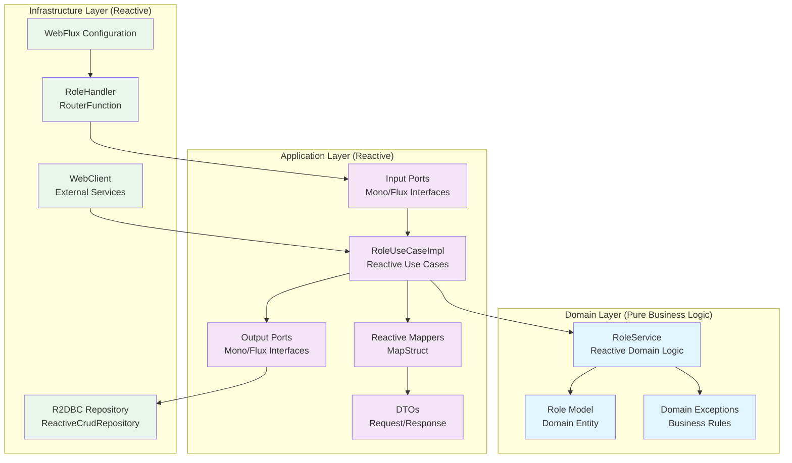
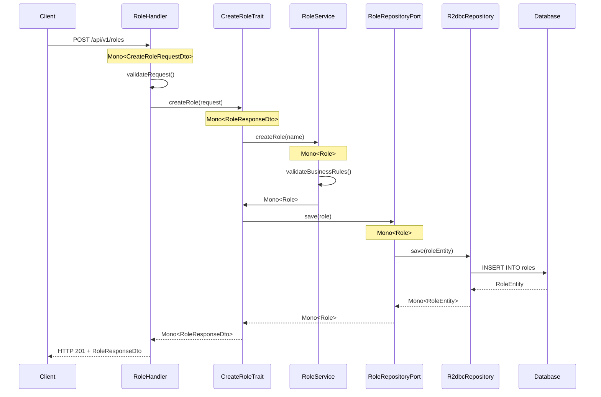

# Hex4WebFlux (hex4w) - Plantilla de Arquitectura Hexagonal Reactiva

Una implementación completa de arquitectura hexagonal (patrón Ports and Adapters) utilizando Spring Boot WebFlux para programación reactiva.

## Características

- **Programación Reactiva**: Construido con Spring Boot WebFlux para operaciones no bloqueantes y reactivas
- **Arquitectura Hexagonal**: Separación clara de responsabilidades con capas de dominio, aplicación e infraestructura
- **Integración R2DBC**: Acceso reactivo a base de datos con H2 en memoria
- **Enrutamiento Funcional**: Enrutamiento basado en RouterFunction en lugar de controladores tradicionales
- **Testing Integral**: Testing reactivo con StepVerifier y WebTestClient
- **Integración MapStruct**: Mapeo automático entre DTOs y modelos de dominio
- **Manejo de Errores Reactivo**: Manejo centralizado de excepciones con GlobalErrorHandler
- **Logging Reactivo**: Aspectos de logging adaptados para programación reactiva
- **GraphQL BFF**: Endpoint GraphQL como Backend For Frontend sobre XDB (/abc)
- **gRPC Client**: Adaptador cliente gRPC para consumir XDB vía protobuf (perfil `grpc`, puerto 9991)
- **Resilience**: resilience4j en adaptadores de infraestructura — Circuit Breaker + Bulkhead + Rate Limiter compuestos en un `OutboundGuard` (AbcAdapter, LambdaAdapter, S3StoreAdapter, salvo SmtpEmailAdapter)
- **Consumidores de eventos**: Kafka, RabbitMQ y SQS con semántica de entrega explícita (el offset/ack avanza solo cuando el trabajo terminó)
- **Scripts con acceso a infraestructura**: GraalVM JS scripts pueden usar servicios XDB, Lambda, S3, Eventos, Email, Cache vía facade

## Requisitos Previos

- **Java 25** (`sdk use java 25.0.2-graalce`) — obligatorio, no solo recomendado
- **Gradle 9+** (el wrapper fija 9.7.1)
- **Git** para clonar el repositorio

## Arquitectura Hexagonal Reactiva

### Estructura de Paquetes

```
    __________________
  ./ co.onmind.hex4w /
  |
  |-- domain/                   # Capa de Dominio (Core Business Logic)
  |   |-- models/               # Entidades de dominio
  |   |-- services/             # Servicios de dominio reactivos
  |   `-- exceptions/           # Excepciones de dominio
  |-- application/              # Capa de Aplicacion (Use Cases)
  |   |-- dto/
  |   |   |-- in/               # DTOs de entrada
  |   |   `-- out/              # DTOs de salida
  |   |-- mappers/              # Mappers reactivos entre DTOs y modelos
  |   |-- usecases/             # Implementaciones de casos de uso reactivos
  |   `-- ports/
  |       |-- in/               # Puertos de entrada reactivos (Use Cases)
  |       `-- out/              # Puertos de salida reactivos (Repositories)
  |-- infrastructure/           # Capa de Infraestructura (Adapters)
  |   |-- configuration/        # Configuraciones de Spring WebFlux
  |   |-- handlers/             # Handlers reactivos (RouterFunction + ServerResponse, incluye AbcGraphqlResolver)
  |   |-- lambda/               # Adaptador para invocacion de Lambda (LambdaAdapter)
  |   |-- events/               # Eventos (Kafka, SQS, SNS, EventBridge)
  |   |-- persistence/          # Implementaciones de persistencia R2DBC
  |   |   |-- adapters/         # Adaptadores de repositorio
  |   |   |-- entities/         # Entidades R2DBC
  |   |   |-- mappers/          # Mappers de entidades
  |   |   `-- repositories/     # Repositorios R2DBC
  |   |-- cache/                # Adaptadores de cache (Redis)
  |   `-- webclients/           # Clientes web reactivos para servicios externos
  |       |-- AbcAdapter          # Adaptador para XDB HTTP (implementa AbcPort)
  |       |-- GrpcAbcAdapter      # Adaptador para XDB gRPC (implementa AbcPort, perfil 'grpc')
  |       `-- CachedAbcAdapter    # Decorator: cachea responses de /abc via Redis
  `-- transverse/               # Componentes Transversales
      |-- exceptions/           # Manejo global de errores reactivo (GlobalErrorHandler)
      |-- logging/              # Aspectos de logging reactivos
      `-- resilience/           # OutboundGuard (CB + Bulkhead + RateLimiter) reactivo
```

### Diagrama de Arquitectura



## Flujo Reactivo Completo del Ejemplo Role

### 1. Flujo de Creación de Role



### 2. Características Reactivas Clave

- **Mono/Flux**: Todos los métodos retornan tipos reactivos
- **Non-blocking**: Operaciones no bloqueantes en toda la aplicación
- **Backpressure**: Manejo automático de contrapresión
- **Error Handling**: Manejo reactivo de errores con `onErrorResume`
- **Composition**: Composición de operaciones reactivas con `flatMap`, `map`, etc.

### 3. Manejo de Errores (GlobalErrorHandler vs. Handlers)

La plantilla cuenta con **dos capas** de manejo de errores que conviven, y es
importante entender cuándo actúa cada una:

#### a. `GlobalErrorHandler` (centralizado)
Ubicado en `transverse/exceptions/GlobalErrorHandler.java`, implementa
`ErrorWebExceptionHandler` con `@Order(-2)`. Intercepta **cualquier excepción no
capturada** en el pipeline de WebFlux y la convierte en una respuesta JSON
estándar con 5 campos: `code`, `message`, `status`, `timestamp` y `path`.

Mapeo de excepciones a HTTP status:

| Excepción | HTTP Status | code |
|---|---|---|
| `DuplicateRoleException` | 409 CONFLICT | `DUPLICATE_ROLE` |
| `RoleNotFoundException` | 404 NOT_FOUND | `ROLE_NOT_FOUND` |
| `ScriptNotAllowedException` | 403 FORBIDDEN | `SCRIPT_NOT_ALLOWED` |
| `IllegalArgumentException` | 400 BAD_REQUEST | `INVALID_REQUEST` |
| `JsonProcessingException` | 400 BAD_REQUEST | `INVALID_JSON` |
| `BulkheadFullException` / `RequestNotPermitted` | 503 SERVICE_UNAVAILABLE | `SERVICE_OVERLOADED` |
| Cualquier otra | 500 INTERNAL_SERVER_ERROR | `INTERNAL_ERROR` |

Los rejections del bulkhead y del rate limiter son **decisiones de descarte de carga**, no
fallos del downstream: se responden 503 para que el cliente pueda reintentar con backoff, en
lugar de un 500 que lo presentaría como un error del servidor.

#### b. `handleError` por Handler (frontera)
Cada handler en `infrastructure/handlers/` (p. ej. `RoleHandler`,
`ScriptingHandler`, `StoreHandler`) implementa su propio
`.onErrorResume(this::handleError)` y un `record ErrorResponse` local de **3
campos** (`code`, `message`, `status`). Esta capa captura el error **dentro del
flujo reactivo del handler**, antes de que llegue al `GlobalErrorHandler`.

#### ¿Por qué existen ambas y cuál predomina?
- En la **aplicación en ejecución**, la excepción se resuelve en el primer
  `onErrorResume` que la intercepte. Si el handler la maneja, se usa el formato
  de 3 campos, si no, la excepción sube y el `GlobalErrorHandler` la formatea
  con 5 campos.
- En los **tests aislados de handler** (`*WebFluxIntegrationTest`), el
  `WebTestClient` se construye manualmente solo con el handler y el
  `RouterFunction`, **sin** registrar el `GlobalErrorHandler` en el pipeline. Por
  lo tanto, en ese contexto el `GlobalErrorHandler` no interviene y el
  `handleError` del handler es la única fuente de mapeo de errores. Es por eso
  que los handlers mantienen su propio `handleError` y no delegan todo al
  centralizado.

> **Nota de diseño:** Si en el futuro se quiere unificar en el `GlobalErrorHandler`,
> habría que registrarlo también en los `WebTestClient` de los tests de handler
> (o migrar esos tests a `@WebFluxTest` con el contexto completo), y unificar el
> formato de `ErrorResponse` en un único record compartido.

## Inicio Rápido

### Instalación y Ejecución

1. **Clonar el repositorio**:
```bash
git clone https://github.com/kaesar/onmind-hex4w.git hex4w
cd hex4w
```

2. **Ejecutar la aplicación**:
```bash
./gradlew bootRun
```

La aplicación se iniciará en el puerto 8080.

3. **Verificar que la aplicación esté funcionando**:
```bash
curl http://localhost:8080/health
```

### Ejecutar Tests

```bash
# Ejecutar todos los tests
./gradlew test

# Ejecutar tests con reporte de cobertura
./gradlew test jacocoTestReport

# Ejecutar solo tests unitarios
./gradlew test --tests "*Test"

# Ejecutar solo tests de integración
./gradlew test --tests "*IntegrationTest"
```

## API Endpoints

### Endpoints Reactivos Disponibles

| Método | Endpoint | Descripción | Request Body | Response |
|--------|----------|-------------|--------------|----------|
| `POST` | `/api/v1/roles` | Crear un nuevo role | `CreateRoleRequestDto` | `RoleResponseDto` |
| `GET`  | `/api/v1/roles` | Obtener todos los roles | - | `Flux<RoleResponseDto>` |
| `GET`  | `/api/v1/roles/{id}` | Obtener role por ID | - | `RoleResponseDto` |
| `GET`  | `/api/v1/roles/search?name={pattern}` | Buscar roles por patrón de nombre | - | `Flux<RoleResponseDto>` |
| `POST` | `/api/v1/script/execute` | Ejecutar archivo `.js` whitelisteado (GraalJS) | `{ "script": "hello.js" }` | `ScriptResultResponseDto` |
| `GET` | `/api/v1/xdb/sheet` | Listar hojas XDB (prueba AbcWebClient) | - | `SheetResponseDto` |
| `GET`  | `/api/v1/store/items?bucket={name}` | Listar objetos de un bucket S3 | - | `Flux<StoreItemResponseDto>` |
| `POST` | `/graphql` | Endpoint GraphQL (BFF sobre XDB) — habilitado con `app.graphql.enabled=true` | GraphQL query | GraphQL response |
| `gRPC` | `localhost:9991` | Cliente gRPC hacia XDB — habilitado con perfil `grpc` | `AbcRequest` proto | `AbcResponse` proto |

### Ejemplos de Uso

#### Crear un Role
```bash
curl -X POST http://localhost:8080/api/v1/roles \
  -H "Content-Type: application/json" \
  -d '{"name": "ADMIN"}'
```

**Respuesta**:
```json
{
  "id": 1,
  "name": "ADMIN",
  "createdAt": "2024-01-15T10:30:00"
}
```

#### Obtener todos los Roles
```bash
curl http://localhost:8080/api/v1/roles
```

**Respuesta**:
```json
[
  {
    "id": 1,
    "name": "ADMIN",
    "createdAt": "2024-01-15T10:30:00"
  },
  {
    "id": 2,
    "name": "USER",
    "createdAt": "2024-01-15T10:31:00"
  }
]
```

#### Obtener Role por ID
```bash
curl http://localhost:8080/api/v1/roles/1
```

#### Buscar Roles por Nombre
```bash
curl "http://localhost:8080/api/v1/roles/search?name=ADM"
```

#### Ejecutar Script JavaScript (archivo whitelisteado)

Ruta: `POST /api/v1/script/execute`  
Body: `{ "script": "<nombre-archivo.js>" }` → `{ value, stdout, stderr }`

Solo se ejecutan archivos listados en `app.scripts.whitelist` (application.yml) y presentes en
`src/main/resources/scripts/` (config: `app.scripts.location`).

| Archivo |
|---------|
| `hello.js` |
| `example.js` |
| `services.js` |

```yaml
# application.yml
app:
  scripts:
    location: classpath:scripts/
    whitelist: hello.js,example.js,services.js
```

Para registrar un nuevo script: agregar el nombre a la lista `whitelist` (sin recompilar).
Para sobre-escribir en runtime: `--app.scripts.whitelist=hello.js,services.js`, o vía env var.

**Respuesta** (ejemplo):
```json
{
  "value": "Hello from hex4w scripts!",
  "stdout": "",
  "stderr": null
}
```

Flujo: nombre → `ScriptWhitelist` (scripts.ini) → carga classpath → `GraalJsAdapter` (sandbox).  
Para ABCode: transpilar a `.js`, copiar a `scripts/` y agregar nombre a `scripts.ini`.  
Nombre no permitido → `403 SCRIPT_NOT_ALLOWED`.

#### XDB - Sheet (XdbcUseCase + AbcWebClient)

Ruta: `GET /api/v1/xdb/sheet`  

Endpoint de prueba que consume XDB (base de datos en `../api/xdb` Kotlin) vía
`AbcWebClient.sheet()`. Devuelve el listado de hojas/colecciones.

```bash
curl http://localhost:8080/api/v1/xdb/sheet
```

**Respuesta** (ejemplo):
```json
{
  "ok": true,
  "status": 200,
  "message": "OK",
  "total": 5,
  "data": [
    { "kit01": "1", "kit02": "Hoja A", "kit03": "Title A" }
  ]
}
```

Flujo hexagonal: `XdbcHandler` → `XdbcSheetTrait` → `XdbcUseCase` → `AbcPort` (`CachedAbcAdapter` → `AbcAdapter` → `AbcWebClient`) → XDB.

**Configuración** (`application.yml`):
```yaml
app:
  xdb:
    base-url: http://localhost:8082
    default-from: xykit
    default-some: sheet
```

**Operaciones del cliente `AbcWebClient`:**

| Método | Descripción | Parámetros clave |
|--------|-------------|------------------|
| `sheet(show, from, some)` | Listar hoja/colección | `show`, `from`, `some` |
| `find(request)` | Buscar registros | `from`, `some`, `where`, `show`, `sort`, `limit`, `offset` |
| `insert(request)` | Insertar registro | `from`, `some`, `puts` (datos) |
| `update(request)` | Actualizar registro | `from`, `some`, `puts`, `where` |
| `remove(request)` | Eliminar registro | `from`, `some`, `where` |
| `create(request)` | Crear colección | `from`, `some` |
| `drop(request)` | Borrar colección | `from`, `some` |
| `define(request)` | Definir esquema | `from`, `some`, `puts` (spec: `col=alias,...`) |
| `whoami()` | Identidad usuario | — |
| `signup(data)` | Registro usuario | `data` map |
| `ask(request)` | Genérico (rutea por `what`) | `what` + params |

**Respuesta estándar** (`AbcResponse`):
```json
{
  "ok": true,
  "status": 200,
  "message": "OK",
  "total": 10,
  "data": [...]
}
```

#### Listar Objetos de un Bucket S3
```bash
curl "http://localhost:8080/api/v1/store/items?bucket=my-bucket"
```

**Respuesta**:
```json
[
  {
    "key": "documents/report.pdf",
    "size": 102400,
    "lastModified": "2024-01-15T10:30:00",
    "eTag": "\"d41d8cd98f00b204e9800998ecf8427e\""
  }
]
```

### AWS EFS (Elastic File System)

EFS es un sistema de archivos NFS montado en el host/container. **No se necesita
un adapter AWS SDK para operaciones de archivo** (read/write/list) — funciona
con `java.nio.file` estándar (NIO.2) siempre que EFS esté montado.

#### Configuración (EFS montado en /mnt/efs)

```yaml
app:
  scripts:
    location: file:/mnt/efs/scripts/  # ruta EFS montada
```

`ClasspathScriptSourceAdapter` usa `java.nio.file.Paths` — funciona con EFS
transparentemente. Si la ruta no existe (EFS no montado en local), el adapter
caerá al classpath (`classpath:scripts/`).

**Nota:** El AWS SDK (`software.amazon.awssdk.services.efs.EfsClient`) solo se
usa para operaciones de gestión (create/delete filesystem), no para I/O de
archivos.

## Configuración

### Dependencias Reactivas Principales

El proyecto utiliza las siguientes dependencias clave para programación reactiva:

```gradle
dependencies {
    // Spring Boot WebFlux - Framework reactivo principal
    implementation 'org.springframework.boot:spring-boot-starter-webflux'
    
    // Spring Data R2DBC - Acceso reactivo a base de datos
    implementation 'org.springframework.boot:spring-boot-starter-data-r2dbc'
    
    // R2DBC H2 - Driver reactivo para H2
    runtimeOnly 'io.r2dbc:r2dbc-h2'
    runtimeOnly 'com.h2database:h2'
    
    // Validation - Validación de datos
    implementation 'org.springframework.boot:spring-boot-starter-validation'
    
    // MapStruct - Mapeo de objetos
    implementation 'org.mapstruct:mapstruct:1.5.5.Final'
    annotationProcessor 'org.mapstruct:mapstruct-processor:1.5.5.Final'
    
    // Testing Reactivo
    testImplementation 'io.projectreactor:reactor-test'
    testImplementation 'org.springframework.boot:spring-boot-starter-test'
}
```

### Configuración de Base de Datos R2DBC

```yaml
spring:
  r2dbc:
    url: r2dbc:h2:mem:///hex4w;DB_CLOSE_DELAY=-1;DB_CLOSE_ON_EXIT=FALSE
    username: sa
    password: password
```

### Configuración de WebFlux

```yaml
server:
  port: 8080

spring:
  webflux:
    base-path: /api/v1
```

### Pool de conexiones de Reactor Netty

```yaml
app:
  webclient:
    connect-timeout: 5000
    read-timeout: 10000
    write-timeout: 10000
    max-memory-size: 1048576
    max-connections: 100
    pending-acquire-max-count: 100
    pending-acquire-timeout: 2000
```

Los defaults de Reactor Netty son `maxConnections = max(availableProcessors, 8) * 2` y
`pendingAcquireMaxCount = 256` con un `pendingAcquireTimeout` de **45 s**. Ese último es el
problema: el exceso de peticiones se **encola** hasta 45 segundos en lugar de rechazarse, así que
una ráfaga contra un downstream lento se convierte en una pila de latencia en lugar de un fallo
rápido. Estos valores hacen que el exceso falle rápido. El bulkhead del `OutboundGuard` rechaza
antes, lo que queda es la última línea de defensa.

### Configuración XDB (AbcWebClient)

```yaml
app:
  xdb:
    base-url: http://localhost:8082      # XDB server URL
    default-some: sheet                  # Default collection identifier
    auth-type: none                      # none | bearer | basic
    auth-token: ""                       # token or user:pass for basic
```

### Kafka (opcional, perfil `kafka`)

Habilita un consumidor reactivo que ejecuta scripts vía mensajes Kafka.

#### Activación

```bash
./gradlew bootRun --spring.profiles.active=dev,kafka
```

#### Configuración (`application-kafka.yml`)

```yaml
app:
  kafka:
    bootstrap-servers: localhost:9092
    topic:
      script-commands: hex4w.script.commands
      script-results: hex4w.script.results
```

#### Mensaje de comando (entrada, topic `hex4w.script.commands`)

```json
{
  "script": "hello.js",
  "correlationId": "req-123"
}
```

El consumidor (`ScriptKafkaConsumer`) ejecuta el script vía `ExecuteScriptTrait` y publica el resultado.

#### Mensaje de resultado (salida, topic `hex4w.script.results`)

Éxito:
```json
{
  "correlationId": "req-123",
  "result": { "value": "Hello from hex4w scripts!", "stdout": "", "stderr": null },
  "error": null
}
```

Error:
```json
{
  "correlationId": "req-123",
  "result": null,
  "error": "Script file not allowed: 'noexiste.js'. Allowed: hello.js, example.js"
}
```

#### Notas
- Kafka deshabilitado por defecto (no requiere broker). `application.yml` excluye `KafkaAutoConfiguration`.
- Perfil `kafka` lo rehabilita y activa `ScriptKafkaConsumer`.
- Dependencia: `org.springframework.kafka:spring-kafka`.

#### Semántica de entrega

El listener **espera a que el trabajo termine antes de retornar** (`.block()` sobre la cadena
reactiva), de modo que el offset solo avanza cuando el resultado ya fue publicado. Suscribir y
retornar dejaba el offset avanzando mientras el script seguía en marcha: una caída a mitad de
camino perdía el comando, y un fallo al publicar el resultado se perdía sin nada que reintentar.

| Situación | Resultado |
|---|---|
| Script falla | se publica el resultado de error y el offset avanza |
| Falla la publicación del resultado | la excepción **propaga** → el contenedor reintenta |
| Payload corrupto | la excepción **propaga** → el error handler del contenedor reintenta unas veces y luego descarta el registro |

### AWS SQS (opcional, perfil `sqs`)

Adaptadores reactivos para colas SQS usando `SqsAsyncClient` del AWS SDK v2.

#### Activación

```bash
./gradlew bootRun --spring.profiles.active=dev,sqs
```

#### Configuración

```yaml
app:
  sqs:
    queue-url: https://sqs.us-east-1.amazonaws.com/123/my-queue
    topic:
      script-results: https://sqs.us-east-1.amazonaws.com/123/results
    poll-interval-ms: 1000
    visibility-timeout-seconds: 120
```

- `SqsEventSenderAdapter` — publica eventos a SQS implementando `EventPublisherPort`. El `topic` se mapea a `queueUrl`, el `key` a atributo de mensaje.
- `SqsEventConsumerAdapter` — consume mensajes SQS: poll → deserializa `KafkaScriptCommand` → ejecuta script vía `ExecuteScriptTrait` → publica resultado vía `EventPublisherPort` → borra mensaje de la cola.
- `SqsMessagePoller` — **cablea el bucle de polling**, que antes no lo invocaba nadie (el consumidor era código muerto). Es una cadena Reactor pura: no bloquea ningún hilo, el long-poll de 20 s lo resuelve el cliente async del SDK, y la suscripción se **reanuda** tras cada lote en lugar de re-suscribirse en un timer (que produciría una ráfaga cuando un poll tarda más que el intervalo). El ciclo se inicia en `@PostConstruct` y se detiene en `@PreDestroy`.

#### Semántica de entrega

| Situación | Resultado | ¿Se borra el mensaje? |
|---|---|---|
| Script falla | se publica el resultado de error | **Sí** → se consume |
| Falla la publicación del resultado | propaga | **No** → se reintenta |
| Payload corrupto (poison) | se registra | **Sí** → se consume |

Que un script fallido **consuma** el mensaje es deliberado: dejarlo en la cola lo haría reaparecer
tras el `visibilityTimeout` y volvería a ejecutar el script indefinidamente. Si se requieren
reintentos automáticos, la vía correcta es una **redrive policy (DLQ)** de SQS.

#### `visibilityTimeout` y duración del script

`app.sqs.visibility-timeout-seconds` (120) **debe ser mayor** que el tiempo máximo que un script
puede tardar. Si no, el mensaje reaparece mientras todavía se está procesando y el script se
ejecuta dos veces en paralelo.

```yaml
app:
  scripts:
    statement-limit: 5000000   #statements máximos antes de que GraalVM cancele el script
  sqs:
    visibility-timeout-seconds: 120
```

### RabbitMQ (opcional, perfil `rabbitmq`)

Adaptadores para RabbitMQ usando Spring AMQP (`RabbitTemplate` + `@RabbitListener`). El patrón es idéntico al de Kafka.

#### Activación

```bash
./gradlew bootRun --spring.profiles.active=dev,rabbitmq
```

#### Configuración

```yaml
spring:
  rabbitmq:
    host: localhost
    port: 5672

app:
  rabbitmq:
    exchange:
      default: hex4w.script.commands
      results: hex4w.script.results
    queue:
      script-commands: hex4w.script.commands
```

- `RabbitMQEventPublisherAdapter` — publica eventos implementando `EventPublisherPort`. El `topic` se mapea a `exchange`, el `key` a `routingKey`.
- `RabbitMQEventConsumerAdapter` — consume mensajes via `@RabbitListener`, deserializa `KafkaScriptCommand`, ejecuta script vía `ExecuteScriptTrait`, publica resultado vía `EventPublisherPort`.

#### Semántica de entrega

Igual que en Kafka, el listener **espera a que el trabajo termine antes de retornar**, así que el
ack solo ocurre cuando el resultado ya fue publicado.

| Situación | Resultado |
|---|---|
| Script falla | se publica el resultado de error y el mensaje se ack |
| Falla la publicación del resultado | la excepción **propaga** → el contenedor reencola |
| Payload corrupto | se **descarta con log**. A diferencia de Kafka, aquí no se propaga: el contenedor de RabbitMQ reencola por defecto un mensaje rechazado, y un payload corrupto reencolado para siempre sería un bucle infinito |

### AWS SNS (opcional, perfil `sns`)

Adaptador reactivo para topics SNS usando `SnsAsyncClient`.

#### Activación

```bash
./gradlew bootRun --spring.profiles.active=dev,sns
```

#### Configuración

```yaml
app:
  sns:
    topic-arn: arn:aws:sns:us-east-1:123:my-topic
```

- `SnsEventSenderAdapter` — publica eventos a SNS implementando `EventPublisherPort`. El `topic` se mapea a `topicArn`.

### AWS EventBridge (opcional, perfil `eventbridge`)

Adaptador reactivo para buses de eventos usando `EventBridgeAsyncClient`.

#### Activación

```bash
./gradlew bootRun --spring.profiles.active=dev,eventbridge
```

#### Configuración

```yaml
app:
  eventbridge:
    bus: default
```

- `EventBridgeEventSenderAdapter` — publica eventos vía `PutEventsRequest`. El `topic` se mapea a `eventBusName`. Campos: `detailType`="ScriptExecution", `source`="hex4w.application", `detail`=payload.

### gRPC (opcional, perfil `grpc`)

Adaptador cliente gRPC para consumir XDB vía protocol buffers en lugar de HTTP.
Paralelo al adaptador REST (`AbcWebClient`/`AbcAdapter`), implementa `AbcPort`
usando el stub async de gRPC — no bloqueante y compatible con WebFlux.

#### Activación

```bash
./gradlew bootRun --spring.profiles.active=dev,grpc
```

#### Dependencias

```gradle
implementation 'io.grpc:grpc-netty-shaded:1.69.1'
implementation 'io.grpc:grpc-protobuf:1.69.1'
implementation 'io.grpc:grpc-stub:1.69.1'
implementation 'com.google.protobuf:protobuf-java:3.25.5'
implementation files('../api/xdb/build/libs/onmind-xdb-1.0.0-early2026.jar')
```

El JAR de xdb contiene las clases proto generadas (`AbcServiceGrpc`, `AbcRequest`, `AbcResponse`).
Las versiones de gRPC y protobuf coinciden con las de `api/xdb`.

#### Configuración

```yaml
app:
  xdb:
    grpc:
      host: localhost
      port: 9991
```

XDB abre el listener gRPC en el puerto 9991 (configurado en `api/xdb`).

#### Cómo funciona

1. `GrpcConfiguration` (perfil `grpc`) crea un `ManagedChannel` (Netty, plaintext)
   y el `AbcServiceStub` async.
2. `GrpcAbcAdapter` implementa `AbcPort`:
   - `sheet(show, from, some)` → construye `AbcRequest` con `what=find`, llama
     gRPC `Execute`, mapea `AbcResponse` proto → `AbcResponse` DTO.
   - `exec(request)` → mapea campos `AbcRequest` HTTP a proto `AbcRequest`,
     llama gRPC `Execute`.
3. El bean `AbcPort @Primary` en `GrpcConfiguration` envuelve `GrpcAbcAdapter`
   con `CachedAbcAdapter` (cache de lecturas, igual que con el adaptador HTTP).
4. OutboundGuard: `abcGuard` (el mismo guard que usa el adaptador HTTP de XDB).

#### Mapeo de campos

| HTTP AbcRequest | gRPC AbcRequest proto |
|---|---|
| way, what, from, some, with, show, call, puts | → mismo nombre en proto |
| where, sort, limit, offset | → codificados dentro de `puts` JSON |

Los campos `where`, `sort`, `limit`, `offset` no existen en el proto gRPC —
se combinan con `puts` como un JSON unificado (ej. `{"where":{...}, "limit":10, ...}`).

#### Adaptador gRPC sobre EFS (opcional)

EFS (Elastic File System) es un sistema de archivos NFS montado en el host.
No se necesita un adapter AWS SDK para operaciones de archivo — funciona con
`java.nio.file` estándar. Si EFS está montado (ej. en `/mnt/efs/scripts/`):

```yaml
app:
  scripts:
    location: file:/mnt/efs/scripts/
```

`ClasspathScriptSourceAdapter` usa `java.nio.file.Paths` — funciona con EFS
transparentemente. El AWS SDK (`EfsClient`) solo se usa para operaciones de
gestión (create/delete filesystem), no para I/O de archivos.

### Redis Cache (opcional)

Se incluye un adaptador reactivo de cache basado en Redis que cachea respuestas
de lectura del endpoint `/abc` (XDB).  El paquete `infrastructure/cache/`
contiene `RedisCacheAdapter` (implementa `CachePort`), y el decorator
`CachedAbcAdapter` en `infrastructure/webclients/` envuelve a `AbcAdapter`
para interceptar `sheet()` (caché) y pasar `exec()` (escrituras) sin caché.

#### Dependencia

```gradle
implementation 'org.springframework.boot:spring-boot-starter-data-redis'
```

#### Configuración (`application.yml`)

```yaml
spring:
  redis:
    host: localhost
    port: 6379
    timeout: 2000ms

app:
  xdb:
    cache:
      enabled: true          # activa/desactiva el decorator
      ttl-seconds: 300       # vida útil de las entradas cacheadas
```

#### Cómo funciona

1. `XdbcUseCase` inyecta `AbcPort` (no `AbcWebClient` directamente).
2. En `WebClientConfiguration`, el bean `AbcPort` primario (`@Primary`) es un
   `CachedAbcAdapter` que delega a `AbcAdapter`.
3. En `sheet(show, from, some)`:
   - Se genera la key `abc:sheet:{show}:{from}:{some}`.
   - **Cache HIT**: devuelve la respuesta deserializada desde Redis, sin tocar
     el delegate.
   - **Cache MISS**: llama al delegate (`AbcWebClient` → `/abc`), serializa el
     `AbcResponse` a JSON, lo almacena en Redis con el TTL configurado y lo
     devuelve.
4. En `exec(request)`: siempre delega sin caché (operaciones de escritura).
5. Cualquier error de Redis (lectura o escritura) se absorbe silenciosamente
   y se continúa con el delegate, por lo que un broker caído no rompe el flujo.

#### Componentes

| Clase | Paquete | Rol |
|---|---|---|
| `CachePort` | `application/ports/out/` | Puerto de sal genérico (get/set/evict) |
| `RedisCacheAdapter` | `infrastructure/cache/` | Adaptador concreto usando `ReactiveRedisTemplate` (auto-configurado por Spring Boot) |
| `CachedAbcAdapter` | `infrastructure/webclients/` | Decorator de `AbcPort` que cachea `sheet()` |
| — | `infrastructure/configuration/` | Spring Boot auto-configura `ReactiveRedisTemplate<String, String>` |

#### Reutilizar el cache desde otro caso de uso

`CachePort` es genérico: cualquier caso de uso puede inyectarlo directamente
sin crear un nuevo adaptador Redis.  Si solo necesitas cachear un puerto
reactivo (Mono/Flux), crea un decorator como `CachedAbcAdapter`.

```java
// Directo: uso genérico de CachePort
@Component
public class SomeUseCase {
    private final CachePort cachePort;

    public Mono<Result> getData(String id) {
        return cachePort.get("prefix:" + id)
                .switchIfEmpty(fetchFromDb(id)
                    .flatMap(result -> cachePort.set("prefix:" + id, toJson(result), Duration.ofSeconds(60))
                        .onErrorResume(e -> Mono.empty())
                        .thenReturn(result)));
    }
}
```

## Testing Reactivo

### Estrategia de Testing

La aplicación implementa una pirámide de testing reactivo:

1. **Tests Unitarios Reactivos (70%)**
   - Servicios de dominio con `StepVerifier`
   - Casos de uso reactivos
   - Mappers y validaciones

2. **Tests de Integración Reactivos (20%)**
   - Handlers con `WebTestClient`
   - Repositorios R2DBC con `@DataR2dbcTest`

3. **Tests End-to-End Reactivos (10%)**
   - `@SpringBootTest` con `WebTestClient`
   - Flujos completos de API reactiva

### Ejemplo de Test Reactivo

```java
@ExtendWith(MockitoExtension.class)
class RoleServiceTest {
    
    @Test
    void shouldCreateRoleReactively() {
        // Given
        String roleName = "ADMIN";
        Role expectedRole = new Role(roleName);
        
        // When
        Mono<Role> result = roleService.createRole(roleName);
        
        // Then
        StepVerifier.create(result)
            .expectNext(expectedRole)
            .verifyComplete();
    }
}
```

### Test de Handler con WebTestClient

```java
@WebFluxTest(RoleHandler.class)
class RoleHandlerTest {
    
    @Autowired
    private WebTestClient webTestClient;
    
    @Test
    void shouldCreateRoleViaHandler() {
        // Given
        CreateRoleRequestDto request = new CreateRoleRequestDto("ADMIN");
        
        // When & Then
        webTestClient.post()
            .uri("/api/v1/roles")
            .bodyValue(request)
            .exchange()
            .expectStatus().isCreated()
            .expectBody(RoleResponseDto.class)
            .value(response -> {
                assertThat(response.name()).isEqualTo("ADMIN");
                assertThat(response.id()).isNotNull();
            });
    }
}
```

## Desarrollo y Extensión

### Diferencias Clave con hex4j (Spring MVC)

| Aspecto | hex4j (Spring MVC) | hex4w (WebFlux) |
|---------|-------------------|-------------------------|
| **Framework** | Spring MVC | Spring WebFlux |
| **Modelo de Programación** | Imperativo/Bloqueante | Reactivo/No-bloqueante |
| **Controladores** | `@RestController` | `RouterFunction` + `Handler` |
| **Persistencia** | JPA/Hibernate | R2DBC |
| **Tipos de Retorno** | Objetos directos | `Mono<T>` / `Flux<T>` |
| **Testing** | MockMvc | WebTestClient + StepVerifier |
| **Base de Datos** | H2 con JDBC | H2 con R2DBC |

### Cómo Extender la Plantilla con Nuevas Entidades

#### 1. Crear el Modelo de Dominio

```java
// domain/models/User.java
public class User {
    private Long id;
    private String username;
    private String email;
    private LocalDateTime createdAt;
    
    // Constructor, getters, setters, business logic
}
```

#### 2. Crear el Servicio de Dominio Reactivo

```java
// domain/services/UserService.java
@Service
public class UserService {
    
    public Mono<User> createUser(String username, String email) {
        return Mono.fromCallable(() -> {
            // Validaciones de negocio
            validateUsername(username);
            validateEmail(email);
            return new User(username, email);
        });
    }
    
    public Mono<Void> validateBusinessRules(User user) {
        // Lógica de validación reactiva
        return Mono.empty();
    }
}
```

#### 3. Definir DTOs

```java
// application/dto/in/CreateUserRequestDto.java
public record CreateUserRequestDto(
    @NotBlank String username,
    @Email String email
) {}

// application/dto/out/UserResponseDto.java
public record UserResponseDto(
    Long id,
    String username,
    String email,
    LocalDateTime createdAt
) {}
```

#### 4. Crear Puertos Reactivos

```java
// application/ports/in/CreateUserTrait.java
public interface CreateUserTrait {
    Mono<UserResponseDto> createUser(CreateUserRequestDto request);
}

// application/ports/out/UserRepositoryPort.java
public interface UserRepositoryPort {
    Mono<User> save(User user);
    Mono<User> findById(Long id);
    Flux<User> findAll();
    Mono<Boolean> existsByUsername(String username);
}
```

#### 5. Caso de Uso Reactivo por Implementar

```java
// application/usecases/UserUseCase.java
@Component
public class UserUseCase implements CreateUserTrait, GetUserTrait {
    
    private final UserService userService;
    private final UserRepositoryPort userRepository;
    private final UserMapper userMapper;
    
    @Override
    public Mono<UserResponseDto> createUser(CreateUserRequestDto request) {
        return Mono.just(request)
            .map(userMapper::toEntity)
            .flatMap(user -> userService.createUser(user.getUsername(), user.getEmail()))
            .flatMap(userService::validateBusinessRules)
            .flatMap(userRepository::save)
            .map(userMapper::toResponseDto);
    }
}
```

#### 6. Crear Entidad R2DBC y Repositorio

```java
// infrastructure/persistence/entities/UserEntity.java
@Table("users")
public class UserEntity {
    @Id
    private Long id;
    
    @Column("username")
    private String username;
    
    @Column("email")
    private String email;
    
    @Column("created_at")
    private LocalDateTime createdAt;
}

// infrastructure/persistence/repositories/R2dbcUserRepository.java
public interface R2dbcUserRepository extends ReactiveCrudRepository<UserEntity, Long> {
    Mono<Boolean> existsByUsername(String username);
    Mono<UserEntity> findByEmail(String email);
}
```

#### 7. Implementar Adaptador de Persistencia

```java
// infrastructure/persistence/adapters/UserRepositoryAdapter.java
@Repository
public class UserRepositoryAdapter implements UserRepositoryPort {
    
    private final R2dbcUserRepository r2dbcRepository;
    private final UserEntityMapper entityMapper;
    
    @Override
    public Mono<User> save(User user) {
        return Mono.just(user)
            .map(entityMapper::toEntity)
            .flatMap(r2dbcRepository::save)
            .map(entityMapper::toDomain);
    }
}
```

#### 8. Crear Handler Reactivo

```java
// infrastructure/handlers/UserHandler.java
@Component
public class UserHandler {
    
    private final CreateUserTrait CreateUserTrait;
    private final GetUserTrait GetUserTrait;
    
    public Mono<ServerResponse> createUser(ServerRequest request) {
        return request.bodyToMono(CreateUserRequestDto.class)
            .flatMap(CreateUserTrait::createUser)
            .flatMap(user -> ServerResponse.status(HttpStatus.CREATED)
                .contentType(MediaType.APPLICATION_JSON)
                .bodyValue(user))
            .onErrorResume(this::handleError);
    }
}
```

#### 9. Configurar Rutas

```java
// infrastructure/configuration/UserRouterConfiguration.java
@Configuration
public class UserRouterConfiguration {
    
    @Bean
    public RouterFunction<ServerResponse> userRoutes(UserHandler userHandler) {
        return RouterFunctions
            .route(POST("/api/v1/users"), userHandler::createUser)
            .andRoute(GET("/api/v1/users"), userHandler::getAllUsers)
            .andRoute(GET("/api/v1/users/{id}"), userHandler::getUserById);
    }
}
```

### Mejores Prácticas para Desarrollo Reactivo

1. **Evitar Bloqueos**: Nunca usar `.block()` en código de producción
2. **Composición**: Usar `flatMap`, `map`, `filter` para componer operaciones
3. **Manejo de Errores**: Usar `onErrorResume`, `onErrorReturn` para manejo reactivo de errores
4. **Testing**: Siempre usar `StepVerifier` para testing de streams reactivos
5. **Backpressure**: Considerar estrategias de backpressure para streams grandes
6. **Schedulers**: Usar schedulers apropiados para operaciones CPU-intensivas

## Resilience (Circuit Breaker + Bulkhead + Rate Limiter)

Los adaptadores de infraestructura que llaman a servicios externos están protegidos con
**tres políticas de resilience4j** compuestas en un `OutboundGuard`
(`transverse/resilience/OutboundGuard.java`), que envuelve el `Mono`/`Flux` con los operadores
de Reactor.

### Dependencias

```gradle
implementation 'io.github.resilience4j:resilience4j-reactor:2.2.0'
implementation 'io.github.resilience4j:resilience4j-circuitbreaker:2.2.0'
implementation 'io.github.resilience4j:resilience4j-bulkhead:2.2.0'
implementation 'io.github.resilience4j:resilience4j-ratelimiter:2.2.0'
```

### Orden de composición (importante)

```
RateLimiter  →  Bulkhead  →  CircuitBreaker  →  llamada
```

- **Rate limiter** (el más externo) — rechaza el exceso de llamadas antes de que ocupe una ranura
  de concurrencia y antes de tocar el downstream.
- **Bulkhead** — acota cuántas llamadas están **en vuelo** a la vez. El pool de conexiones de
  Reactor Netty no puede ofrecer esto: encola el exceso (256 pending acquires, 45 s) en lugar de
  rechazarlo, de modo que una ráfaga se convierte en una pila de latencia en vez de un fallo rápido.
- **Circuit breaker** (el más interno) — solo observa fallos reales del downstream. Un rejection
  del bulkhead o del rate limiter **no** es un fallo del downstream y nunca abre el breaker.

> `transformDeferred` **envuelve** el publisher, así que el operador aplicado *último* queda
> fuera. La cadena se escribe por eso en orden inverso de suscripción: el circuit breaker se
> aplica primero (el más interno) y el rate limiter el último (el más externo).

### Beans

Los beans se definen en `ResilienceConfiguration` (no en `WebClientConfiguration`):

| Bean | Servicio protegido |
|---|---|
| `abcGuard` | XDB `/abc` (HTTP y gRPC) |
| `lambdaGuard` | AWS Lambda invocation |
| `s3Guard` | AWS S3 operations |

Config del circuit breaker: failure-rate 50%, window 10, min 5 calls, 30s open, 3 half-open calls.

### Configuración

```yaml
app:
  resilience:
    abc:
      max-concurrent-calls: 20
      rate-limit-per-period: 50
    s3:
      max-concurrent-calls: 10
      rate-limit-per-period: 20
    lambda:
      max-concurrent-calls: 10
      rate-limit-per-period: 20
```

El bloque es **opcional**: los defaults de `ResilienceProperties` ya son razonables. Tanto el
bulkhead como el rate limiter **rechazan de inmediato** por defecto (`max-wait-ms` y
`rate-limit-timeout-ms` en 0). Subirlos convierte el rechazo en una espera.

> El `timeoutDuration` por defecto del rate limiter de resilience4j es **5 s**, no 0. Con ese
> valor el operador *retrasa* la suscripción en vez de rechazar, así que el efecto real sería
> "suavizar el pico" y no "descartar carga".

### Adaptadores con OutboundGuard

| Adaptador | Bean inyectado |
|---|---|
| `AbcAdapter` | `abcGuard` |
| `GrpcAbcAdapter` | `abcGuard` |
| `LambdaAdapter` | `lambdaGuard` |
| `S3StoreAdapter` | `s3Guard` |

### Adaptadores SIN OutboundGuard

| Adaptador | Razón |
|---|---|
| `SmtpEmailAdapter` | Email es best-effort. Un SMTP lento pero funcional no debe bloquear la entrega. Retry es preferible a fast-fail. |

### Respuesta HTTP ante un rechazo

Un rejection del bulkhead o del rate limiter se traduce a **503 Service Unavailable**
(`SERVICE_OVERLOADED`) en `GlobalErrorHandler`, no a un 500.

## Notificaciones (Email)

### Arquitectura

`EmailPort` (puerto de salida) + `SmtpEmailAdapter` (adaptador concreto) en
`infrastructure/notification/`. El adaptador está registrado como `@Component`
y usa `JavaMailSender` de Spring Boot (auto-configurado vía `spring.mail.*`).

El envío es reactivo: `JavaMailSender.send()` (bloqueante) se envuelve en
`Mono.fromCallable().subscribeOn(Schedulers.boundedElastic()).then()` para no
bloquear el event loop de Netty.

### Configuración

```yaml
spring:
  mail:
    host: localhost
    port: 1025
    username: ""   # sin autenticación para Mailpit local
    password: ""

app:
  notification:
    email:
      from: noreply@hex4w.local
      endpoint-enabled: false   # true para habilitar el endpoint POST /api/v1/notifications/email
```

### Endpoint de Envio de Email

El endpoint está **deshabilitado por defecto**. Para habilitarlo:

```yaml
app:
  notification:
    email:
      endpoint-enabled: true
```

O al lanzar la aplicación: `./gradlew bootRun --args='--app.notification.email.endpoint-enabled=true'`

**Endpoint:**
```
POST /api/v1/notifications/email
Content-Type: application/json
```

**Body:**
```json
{
  "to": "user@example.com",
  "subject": "Hello",
  "from": "noreply@hex4w.local",
  "cc": ["admin@example.com"],
  "body": "Mensaje de prueba"
}
```

`from` y `cc` son opcionales. Si `from` no se envía, se usa el valor de `app.notification.email.from`.

**Respuesta exitosa (200):**
```json
{"message": "Email queued successfully"}
```

### Testing con Mailpit

Mailpit simula un servidor SMTP y expone una API HTTP para inspeccionar emails.

```bash
# Iniciar Mailpit
docker run -d -p 1025:1025 -p 8025:8025 mailpit/mailpit

# Ver emails enviados
curl http://localhost:8025/api/v1/messages
```

El test de integración (`SmtpEmailAdapterIntegrationTest`) conecta a Mailpit en
`localhost:1025` (SMTP) y `localhost:8025` (API). El test se salta
automáticamente (`assumeTrue`) si Mailpit no está disponible.

## Monitoreo y Observabilidad

### Endpoints de Actuator

La aplicación incluye endpoints de monitoreo:

- `/health` - Estado de salud de la aplicación (Actuator, base-path `/`)
- `/info` - Información de la aplicación
- `/metrics` - Métricas de la aplicación
- `/api/health` - Health check custom de la API (sin versión)

### Logging Reactivo

El proyecto incluye logging reactivo configurado:

```yaml
logging:
  level:
    co.onmind.hex4w: DEBUG
    org.springframework.r2dbc: DEBUG
    reactor.netty: INFO
```

## GraphQL (BFF sobre XDB ABC)

hex4w expone un endpoint GraphQL que actúa como **Backend For Frontend** sobre la API
`/abc` de xdb. El resolver (`AbcGraphqlResolver`) consume `AbcSheetUseCase` →
`AbcPort` (`@Primary` CachedAbcAdapter) → `AbcAdapter` → `POST /abc`.

### Configuración

Deshabilitado por defecto. Para habilitar:

```yaml
app:
  graphql:
    enabled: true
```

O al lanzar:
```bash
./gradlew bootRun --args='--app.graphql.enabled=true'
```

El endpoint está en `/graphql`. En modo dev, GraphiQL está en `/graphiql`.

### Queries disponibles

```graphql
# 1. Consulta un sheet individual (equivalente a /api/v1/xdb/sheet)
query {
  abcSheet(show: "orders", from: "customers", some: "id,name") {
    ok status message total data
  }
}

# 2. Consulta múltiples sheets en un solo request (combina conjuntos)
query {
  abcSheets(requests: [
    { show: "orders", from: "customers", some: "id,name" }
    { show: "products", from: "inventory", some: "sku,qty" }
  ]) {
    ok status message total data
  }
}
```

El query `abcSheets` dispara múltiples llamadas `sheet()` en paralelo (via
`Flux.flatMap`) y retorna todas las respuestas combinadas. El cache de Redis
(`CachedAbcAdapter`) aplica a cada sheet individual.

## AWS Lambda (opcional)

Adaptador reactivo para invocación directa de funciones Lambda (sin API Gateway)
usando `LambdaAsyncClient` del AWS SDK v2. El adapter implementa `LambdaPort`
(output port genérico).

### Configuración

```yaml
app:
  lambda:
    region: us-east-1
    endpoint: http://localhost:4566  # LocalStack (opcional)
```

### Uso

```java
@Component
public class MyUseCase {
    private final LambdaPort lambdaPort;

    public Mono<String> process(String input) {
        return lambdaPort.invoke("my-function", "{\"input\":\"" + input + "\"}");
    }
}
```

`LambdaPort.invoke(functionName, payload)` retorna `Mono<String>` con el
response payload de la Lambda. Si Lambda devuelve `functionError`, se lanza
`RuntimeException`. El `LambdaAsyncClient` se configura como un `@Bean` en
`WebClientConfiguration` (region + endpointOverride configurable).

## Scripts con Acceso a Infraestructura (Opción A: HostProxy)

Los scripts JavaScript (GraalVM/GraalJS) pueden interactuar con la
infraestructura disponible a través del facade `ScriptServicesPort`, expuesto
como el objeto global `services` dentro del contexto de ejecución.

### Seguridad

| Medida | Valor |
|---|---|
| `HostAccess` | `HostAccess.ALL` (pero solo el facade está en el contexto) |
| `allowHostClassLookup` | `false` (no se pueden cargar clases Java arbitrarias) |
| `allowHostClassLoading` | `false` |
| `allowIO` | `false` (sin acceso a archivos del host) |
| `allowCreateThread` | `false` |
| `allowNativeAccess` | `false` |
| Límite de trabajo | `app.scripts.statement-limit` (5 000 000) — `ResourceLimits.statementLimit` de GraalVM: al superarlo, el contexto se **cierra** y el script se cancela, lo que libera el worker en lugar de dejarlo girando para siempre |

Los scripts **solo pueden** usar los métodos públicos del facade. No pueden
acceder a `java.lang.Runtime`, leer archivos, abrir sockets, etc.

> **Sobre el límite de tiempo:** GraalVM Community **no tiene *CPU-time boxing***
> (`sandbox.MaxCPUTime` es una función de Enterprise), así que el conteo de statements es la
> única cota disponible. No es un límite de wall-clock: un script bloqueado en I/O a través del
> facade `services.*` no lo cuenta. Para el caso de SQS, `app.sqs.visibility-timeout-seconds`
> debe ser holgadamente mayor que el tiempo máximo que un script pueda tardar.

### API `services.*`

| Método | Descripción | Puerto subyacente |
|---|---|---|
| `abcSheet(show, from, some)` | Query XDB /abc (read) | `AbcPort.sheet()` |
| `abcExec(what, from, some, with, puts)` | XDB /abc (write/exec) | `AbcPort.exec()` |
| `publish(topic, key, payload)` | Publicar evento | `EventPublisherPort` (Kafka/SQS/SNS/EventBridge/RabbitMQ) |
| `invoke(functionName, payload)` | Invocar Lambda (síncrono, espera respuesta) | `LambdaPort.invoke()` |
| `invokeAsync(functionName, payload)` | Invocar Lambda (fire-and-forget, `InvocationType.EVENT`) | `LambdaPort.invokeAsync()` |
| `listItems(bucket)` | Listar objetos S3 | `StorePort` |
| `sendEmail(to, subject, body)` | Enviar email | `EmailPort` |
| `cacheGet(key)` | Leer cache Redis | `CachePort` |
| `cacheSet(key, value)` | Escribir cache (TTL 5 min) | `CachePort` |
| `cacheEvict(key)` | Borrar cache | `CachePort` |

Los métodos son **síncronos** (bloquean el `Mono`/`Flux` interno). Esto es seguro
porque los scripts se ejecutan en `Schedulers.boundedElastic()`.

### Ejemplo

```javascript
// Read from XDB
const sheet = services.abcSheet("id,name", "xykit", "sheet");
console.log("Sheet:", JSON.stringify(sheet));

// Publish an event
services.publish("script.results", "script-1", JSON.stringify({ ok: true }));

// Invoke Lambda
const result = services.invoke("my-function", JSON.stringify({ action: "ping" }));

// Cache
services.cacheSet("last-run", "2026-08-01");
const cached = services.cacheGet("last-run");
```

Ejecutarlo:

```bash
curl -X POST http://localhost:8080/api/v1/script/execute \
  -H "Content-Type: application/json" \
  -d '{"script":"services.js"}'
```

### Transporte XDB (HTTP vs gRPC)

  El facade inyecta `AbcPort`, que Spring resuelve según perfil:

| Perfil | Transporte | Bean `@Primary` |
|---|---|---|
| Default | HTTP/WebClient | `AbcAdapter` |
| `grpc` | gRPC (puerto 9991) | `GrpcAbcAdapter` |

```bash
# HTTP (default)
./gradlew bootRun --spring.profiles.active=dev

# gRPC
./gradlew bootRun --spring.profiles.active=dev,grpc
```

El script usa `services.abcSheet(...)` sin cambios — el transporte es transparente.

### Invoke Lambda: síncrono vs fire-and-forget

| Método | InvocationType | Comportamiento |
|---|---|---|
| `services.invoke(fn, payload)` | `REQUEST_RESPONSE` (default) | Espera a que Lambda termine y devuelve el payload |
| `services.invokeAsync(fn, payload)` | `EVENT` | AWS encola el evento y devuelve inmediatamente (202 Accepted) |

El script usa `services.abcSheet(...)` sin cambios — el transporte es transparente.
